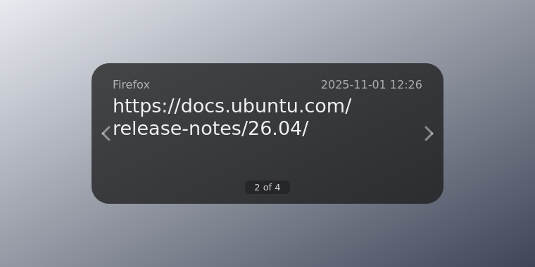
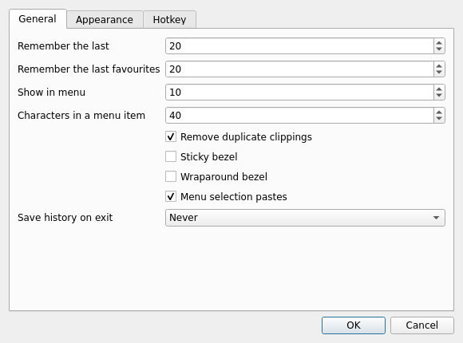
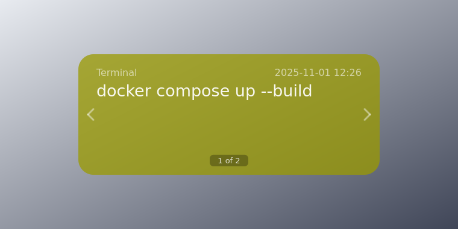

# Mincut

A clipboard manager for Ubuntu with a single idea behind it: your clipboard
history should be one keystroke away and gone again the moment you are done
with it.

Copy as usual. When you need something you copied earlier, press
**Ctrl+Shift+V** and a translucent panel — the *bezel* — opens in the middle of
the screen with your history. Step through it with the arrow keys, press
Return, and the clipping is pasted into whatever you were working in.



Built for Ubuntu 26.04.1 LTS (GNOME 50), but it runs on any Ubuntu from 22.04
onwards, on Wayland or X11.

## Install

```bash
git clone https://github.com/joe7lopes/Ubuntu-mincut.git
cd Ubuntu-mincut
./install.sh
mincut
```

`install.sh` installs the Python package for your user, adds the menu entry and
the autostart file, installs the small GNOME Shell bridge that Wayland needs,
and registers the keyboard shortcut.

Requirements: Python 3.10+, `python3-pyqt6`, and — on Wayland — the
`gnome-shell` extension that ships in `gnome-extension/`. On X11, install
`xclip` and `xdotool` for clipboard polling and paste simulation:

```bash
sudo apt install python3-pyqt6 xclip xdotool
```

## Keys in the bezel

| Key | Action |
| --- | --- |
| Down / Right | Move backward in history (older) |
| Up / Left | Move forward in history (newer) |
| Return | Paste the clipping and close |
| Enter | Move the clipping to the front and close |
| Esc | Close without pasting, keeping the position |
| Home / End | Jump to the most / least recent clipping |
| PgDn / PgUp | Move ten clippings at a time |
| Backspace / Del | Delete the clipping and close |
| 1 … 9, 0 | Jump to position 1–9, or 10 |
| s / S | Save the clipping to a file on the Desktop (S also removes it) |
| f | Switch between history and favourites (the bezel turns warm yellow) |
| F | Move the clipping into favourites and close |
| Mouse wheel, click left/right edge | Same as the arrow keys |

## The menu

The tray icon lists the most recent clippings, and offers **Merge All**
(joins the whole history, oldest first, into one clipping), **Clear All**,
**Pause tracking** for when you are copying passwords, and **Preferences**.



## Favourites

Press **F** on a clipping to keep it in a separate store that does not rotate
away. Press **f** inside the bezel to switch to it — the panel is tinted yellow
so you can always tell which store you are looking at.



## How it works on Wayland

Wayland does not let one application read another application's selection, so
the clipboard has to be reported from inside the shell. `gnome-extension/`
contains a small GNOME Shell extension (`mincut@ubuntu-mincut`) that watches
clipboard changes and hands them to the application over D-Bus, on
`org.mincut.App`. The application itself still owns the history, the bezel and
the settings; the extension is a sensor, not a second copy of the app.

On X11 (`xclip`) and on wlroots compositors (`wl-clipboard`) Mincut polls the
selection directly and no extension is needed.

The keyboard shortcut is registered the same way you would do it yourself in
Settings → Keyboard → Custom Shortcuts, pointing at `mincut toggle`. Under X11
the running instance grabs the key combination directly.

## Files

| Path | Contents |
| --- | --- |
| `~/.config/mincut/config.json` | all settings |
| `~/.local/share/mincut/clips.json` | history and favourites |

## Development

```bash
python3 -m pip install -e .[test]
python3 -m pytest
QT_QPA_PLATFORM=offscreen python3 scripts/render_screenshots.py
```

`scripts/render_screenshots.py` draws the screenshots in `docs/` without a
display, which is also the fastest way to check a change to the bezel layout.

Code map:

| Module | Responsibility |
| --- | --- |
| `mincut/store.py` | clips, history rotation, favourites, persistence format |
| `mincut/keys.py` | every keystroke in the bezel → an action (no GUI imports) |
| `mincut/bezel.py` | the painted panel, its animation and input |
| `mincut/app.py` | controller: clipboard watching, tray, paste, D-Bus |
| `mincut/clipboard.py` | X11 / wlroots / Qt clipboard backends, paste simulation |
| `mincut/hotkey.py` | key grabs on X11, custom keybindings on Wayland |
| `mincut/prefs.py` | preferences dialog |

The store and the key handling are deliberately free of toolkit imports, so
they are tested directly; `tests/test_app_smoke.py` boots the whole
application offscreen and exercises copy → bezel → paste.

## License

MIT — see [LICENSE](LICENSE).
